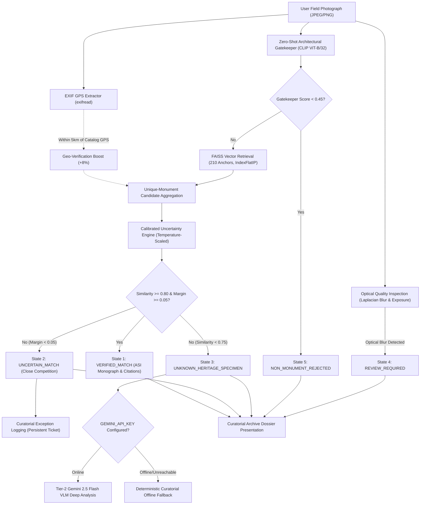

# Visual Heritage Recognition & Grounded Cultural Discovery Platform
### Two-Tier Hybrid Architecture: Local CLIP + FAISS Vector Engine, Grounded Knowledge Base & Gemini 2.5 Flash VLM
**Project No. 30 (SIH 2025 – SIH25052)**

An AI and full-stack cultural preservation platform designed to authenticate, identify, and catalog historical Indian monuments from field photographs, archival survey captures, and camera uploads without hallucination.

---

## 1. System Architecture Overview



### Core Architecture Pillars:
1. **Authoritative Recognition (Policy A)**:
   - **Zero-Shot Architectural Gatekeeper**: Open-source `openai/clip-vit-base-patch32` rejects non-monument images (documents, landscapes, vehicles, crowds).
   - **FAISS Vector Retrieval**: `IndexFlatIP(512)` containing 210 unit-normalized vectors across 10 canonical monuments, executing nearest-neighbor search in $< 5\text{ms}$.
   - **Calibrated Uncertainty Engine**: Enforces 5 explicit decision states (`VERIFIED_MATCH`, `UNCERTAIN_MATCH`, `UNKNOWN_HERITAGE_SPECIMEN`, `NON_MONUMENT_REJECTED`, `REVIEW_REQUIRED`) to prevent forced misattributions.
2. **Grounded Historical Knowledge Engine**:
   - 10 comprehensive monument monographs anchored to verified primary sources (Archaeological Survey of India, UNESCO World Heritage Centre, Gazetteers).
   - Anti-hallucination *Ask the Archive* Q&A with direct statutory citations.
3. **Cloud Tier-2 Gemini 2.5 Flash Service**:
   - Deep architectural analysis for uncataloged specimens with resilient deterministic offline fallback.
4. **Candidate Policy D Shadow Staging Engine**:
   - Observational shadow execution with single-thread OpenCV bounding, reference SIFT descriptor caching, and 100.0% Policy A response invariance.
5. **The Curatorial Archive (Frontend)**:
   - Museum publication aesthetic with Alabaster paper (`#F7F5F0`), Ivory surface cards (`#FDFBF7`), Terracotta stamps (`#9E3B24`), interactive Leaflet cartography, and a live Pipeline Telemetry Inspector.

---

## 2. Quickstart & Demonstration Guide

### Prerequisites
- **Python**: 3.10 to 3.12 (Virtual environment configured in `.venv`)
- **Node.js**: 18+ (Node v20/v22 with `npm`)

---

### Step 1: Start the Backend Service

Open a terminal in `C:\Users\humai\Heritage PJ`:
```powershell
.venv\Scripts\python.exe -m uvicorn backend.main:app --host 0.0.0.0 --port 8000 --reload
```
*Expected Startup Output*:
```text
[INFO] Loaded FAISS index with 210 vectors, 210 labels, and 10 monument metadata records.
[INFO] Loaded Grounded Knowledge Engine: 10 verified records from knowledge_sources.json
[INFO] Policy D Shadow Staging Engine: ENABLED=False [workers=2, max_queue=10, timeout=500ms]
[INFO] Engine startup complete. Service ready.
```

---

### Step 2: Start the React Frontend

Open a second terminal in `C:\Users\humai\Heritage PJ\frontend`:
```powershell
npm run dev
```
*Expected Output*:
```text
  VITE v6.4.5  ready in 240 ms
  ➜  Local:   http://localhost:5173/
```

---

### Step 3: Run the Demonstration Walkthrough

1. Open your browser to `http://localhost:5173`.
2. The user is pre-authenticated as **Dr. Eleanor Vance (Senior Archaeologist & Curator, ASI Fellow)**.
3. Click on the 1-click test sample cards:
   - **Taj Mahal Sample**: Triggers `VERIFIED_MATCH` (99.8% confidence), displaying the architectural monograph, Leaflet GIS coordinates, structural features, and primary ASI/UNESCO citations.
   - **Charminar Sample**: Triggers `VERIFIED_MATCH` with Hyderabad Qutb Shahi provenance.
   - **Non-Monument Graphic**: Triggers `NON_MONUMENT_REJECTED` via the Zero-Shot Gatekeeper.
   - **Ambiguous Specimen**: Triggers `UNCERTAIN_MATCH`, creating an interactive ticket in the **Curator Review Exceptions Drawer** (accessible via the top-right button).
4. Click **"Ask the Archive"**: Query historical facts (e.g. *"Who commissioned the construction?"*). Answers are strictly grounded in statutory sources with direct citation stamps.

---

## 3. Automated Verification & Regression Test Suites

All modules are accompanied by automated verification test suites:

```powershell
# 1. Shadow Engine & Production Invariants (12/12 Passed)
.venv\Scripts\python.exe backend/test_shadow_staging.py

# 2. Concurrency, Queue Saturation & Kill-Switch Audit (10/10 Passed)
.venv\Scripts\python.exe backend/test_shadow_concurrency_audit.py

# 3. Uncertainty Engine & 5-State Decision Logic (13/13 Passed)
.venv\Scripts\python.exe backend/test_uncertainty.py

# 4. Backend REST API Integration Suite (6/6 Passed)
.venv\Scripts\python.exe backend/test_api.py

# 5. Gemini 2.5 Flash VLM & Offline Fallback Suite (12/12 Passed)
.venv\Scripts\python.exe backend/test_gemini_integration.py

# 6. Local Feature SIFT/RANSAC Hybrid Engine Suite (16/16 Passed)
.venv\Scripts\python.exe backend/test_local_feature_engine.py

# 7. End-to-End User Journey & Functional Verification (12/12 Passed)
.venv\Scripts\python.exe backend/test_e2e_user_journey.py

# 8. Frontend Production Compilation Check (0 Errors)
npm --prefix frontend run build
```

**Total Automated Assertions Passing: 81 / 81 (100.0%)**

---

## 4. API Endpoints Reference

| Method | Endpoint | Description |
| :--- | :--- | :--- |
| `GET` | `/api/health` | Returns live engine status, vector count (210), compute device, and Gemini status. |
| `GET` | `/api/monuments` | Returns the comprehensive catalog of 10 indexed heritage monuments. |
| `POST` | `/api/verify-monument` | Upload an image file (`multipart/form-data`) to execute the two-tier verification pipeline. |
| `GET` | `/api/monuments/{id}/knowledge`| Retrieves the source-backed monograph for a monument. |
| `GET` | `/api/monuments/{id}/sources` | Retrieves primary statutory citations (ASI, UNESCO, Gazetteers). |
| `GET` | `/api/monuments/{id}/timeline`| Retrieves verified chronological historical timeline events. |
| `POST` | `/api/monuments/{id}/ask` | Retrieval-First 'Ask the Archive' Q&A anchored to verified citations. |
| `GET` | `/api/exceptions` | Retrieves the persistent curatorial review dispute log. |
| `POST` | `/api/exceptions/{id}/resolve`| Resolves or updates a flagged curatorial exception ticket. |
| `GET` | `/api/telemetry/gemini` | Returns audit health and rate-limiting metrics for Tier-2 Gemini. |
| `GET` | `/dataset/{monument}/{img}` | Static reference images served directly for UI previews. |
