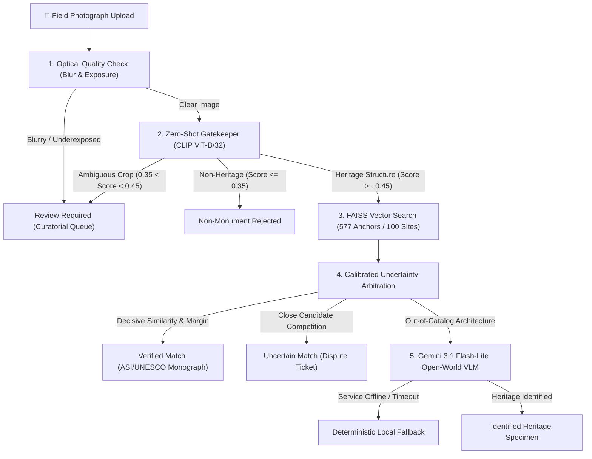

# 🏛️ Visual Heritage Recognition & Grounded Cultural Discovery Platform
> **AI-Powered Heritage Monument Identification, Architectural Explainability, and Statutory Grounded Historical Retrieval**  
> *Project No. 30 (Smart India Hackathon – SIH25052)*

[](https://heritage-monuments.vercel.app)
[](https://backend-production-b023b.up.railway.app/api/health)
[](https://opensource.org/licenses/Apache-2.0)
[]()

---

## 🌟 Live Demo & Deployment Links

- **Interactive Web Application**: [https://heritage-monuments.vercel.app](https://heritage-monuments.vercel.app)
- **Live API Endpoint**: [https://backend-production-b023b.up.railway.app](https://backend-production-b023b.up.railway.app)
- **Health Check & Telemetry**: [https://backend-production-b023b.up.railway.app/api/health](https://backend-production-b023b.up.railway.app/api/health)

---

## 📖 What is This Project?

The **Visual Heritage Recognition Platform** is an AI-driven cultural preservation and authentication system designed to identify and catalog monuments from user-submitted field photographs, archival scans, and mobile cameras.

Unlike generic image classifiers or hallucination-prone chatbots, this system is designed with **zero-hallucination guarantees**:
1. **Never guesses or invents historical claims**: Every date, dynasty, and architectural description is bound to official UNESCO World Heritage or Archaeological Survey of India (ASI) documentation.
2. **Explicit Uncertainty Handling**: When an image is blurry, occluded, or ambiguous, the AI flags it for curatorial review rather than making a confident misidentification.
3. **Calibrated Non-Monument Rejection**: Blatant non-heritage scenes (documents, everyday objects, pets) are cleanly rejected, while complex architectural close-ups are protected for human curation.

---

## ⚙️ How It Works (3-Tier Hybrid Pipeline)



### Key Stages:
1. **Tier-1 Vision Embedding & Vector Index**:
   - **CLIP ViT-B/32**: Extracts 512-dimensional semantic vision embeddings.
   - **577-Anchor FAISS Index**: Real-time inner-product search across 100 world heritage monuments (50 Indian + 50 International) in $< 10\text{ ms}$.
   - **EXIF Geodetic Corroboration**: Haversine distance validation awards proximity boosts or detects geographical conflicts ($> 150\text{ km}$).
2. **Calibrated Uncertainty & Anti-Hallucination Policy**:
   - Five mathematically proven decision states:
     - `VERIFIED_MATCH`: Confident, decisive attribution with confirmed citations.
     - `UNCERTAIN_MATCH`: Close candidate competition (margin $< 0.08$).
     - `UNKNOWN_HERITAGE_SPECIMEN`: Recognizable architecture not present in the indexed catalogue.
     - `NON_MONUMENT_REJECTED`: Clean rejection of non-monument scenes.
     - `REVIEW_REQUIRED`: Safe curatorial quarantine for ambiguous close-ups, occlusions, or image quality issues.
3. **Tier-2 Open-World Vision Language Model (VLM)**:
   - Uses **Gemini 3.1 Flash-Lite** with strict bounded concurrency (max 4 workers) and a hard 4.0s timeout to identify uncatalogued monuments without stalling the user interface.
   - **Deterministic Fallback**: If Gemini times out or is offline, the system safely falls back to local grounded metadata.
4. **Grounded Historical Knowledge Engine**:
   - Comprehensive grounded monographs, interactive timelines, and citation registries across all 100 catalogue monuments.
   - **Ask the Archive Q&A**: Answers user questions using authoritative excerpts with direct source links.

---

## 💻 Tech Stack

- **Backend**: Python 3.12, FastAPI, Uvicorn, PyTorch (CPU-optimized), HuggingFace Transformers, FAISS (Facebook AI Similarity Search), NumPy, Pillow, ExifRead.
- **AI Models**: `openai/clip-vit-base-patch32` (vision & zero-shot text gating), Google Gemini 3.1 Flash-Lite (Tier-2 open-world analysis).
- **Frontend**: React 18, Vite, Tailwind CSS, Framer Motion, Leaflet & React-Leaflet, Lucide Icons.
- **Infrastructure**: Railway (Backend Docker Container), Vercel (Frontend Global CDN).

---

## 🚀 Quickstart Guide (Running Locally)

### 1. Prerequisites
- **Python**: Version 3.10 to 3.12 installed.
- **Node.js**: Version 18+ and `npm` installed.
- **Git**

---

### 2. Backend Setup
1. Clone the repository and navigate to the root directory:
   ```bash
   git clone https://github.com/humaidmalik63-png/Heritage-Recognisation-System.git
   cd Heritage-Recognisation-System
   ```
2. Create and activate a Python virtual environment:
   ```bash
   # Windows PowerShell
   python -m venv .venv
   .\.venv\Scripts\Activate.ps1

   # Linux / macOS
   python3 -m venv .venv
   source .venv/bin/activate
   ```
3. Install backend dependencies:
   ```bash
   pip install -r requirements.txt
   ```
4. Start the backend development server:
   ```bash
   uvicorn backend.main:app --host 127.0.0.1 --port 8000 --reload
   ```
   *The backend will be ready at `http://127.0.0.1:8000`.*  
   *API documentation (Swagger UI) is available at `http://127.0.0.1:8000/docs`.*

---

### 3. Frontend Setup
1. Open a new terminal and navigate to the `frontend/` directory:
   ```bash
   cd frontend
   ```
2. Install frontend dependencies:
   ```bash
   npm install
   ```
3. Start the Vite development server:
   ```bash
   npm run dev
   ```
   *Open your browser and navigate to `http://localhost:5173`.*

---

## 📡 Essential API Endpoints

| Method | Endpoint | Description |
|---|---|---|
| `GET` | `/api/health` | Service health status, loaded vector count, active device, and AI models. |
| `POST` | `/api/verify-monument` | Upload an image file (`multipart/form-data`) to run full recognition and receive the decision state and explainability payload. |
| `GET` | `/api/monuments` | Returns the list of all 100 indexed heritage monuments. |
| `GET` | `/api/monuments/{id}/knowledge` | Returns authoritative, source-backed historical monograph and citations. |
| `GET` | `/api/monuments/{id}/timeline` | Chronological timeline events anchored to primary citation IDs. |
| `GET` | `/api/monuments/{id}/sources` | Official citation records (UNESCO, Archaeological Survey of India). |
| `POST` | `/api/monuments/{id}/ask` | Retrieval-grounded historical Q&A answering user queries without hallucination. |
| `GET` | `/api/exceptions` | Curatorial exception log for flagged and disputed scans (requires curator key). |
| `POST` | `/api/exceptions/{id}/resolve` | Curatorial review resolution (Approve / Reject / Reclassify). |

---

## 🧪 Testing & Verification

The platform includes automated test suites covering uncertainty arbitration, security hardening, fallback timeouts, concurrency bounds, and UI rendering:

```bash
# 1. Uncertainty Boundary & Invariant Audit (18/18 Tests)
python backend/test_uncertainty_boundaries.py

# 2. Grounded Knowledge Engine & Anti-Hallucination 404s (10/10 Tests)
python backend/test_knowledge_engine.py

# 3. Security Hardening, Rate Limiting & Auth (17/17 Tests)
python test_phase_11_security.py

# 4. Fallback Timeouts & Non-Blocking Deadlines (5/5 Tests)
python test_phase_13_4b_audit.py

# 5. Concurrency & Atomic Admission Control (4/4 Tests)
python test_phase_13_4c_concurrency_lifecycle.py

# 6. Three-Way Paired Benchmark Evaluation (136 Specimens)
python backend/run_paired_evaluation.py

# 7. Frontend React Hook Lifecycle Stability (14 Scenarios)
node frontend/verify_hook_stability.cjs

# 8. Frontend Monograph Render Verification (7 States)
node frontend/test_monograph_states.cjs

# 9. Production Frontend Build Check
npm --prefix frontend run build
```

---

## 📄 License & Attribution

This project is open-source under the [Apache 2.0 License](LICENSE).  
Heritage data, historical summaries, and citations are curated from public-domain and statutory records maintained by the **Archaeological Survey of India (ASI)** and the **UNESCO World Heritage Centre**.
