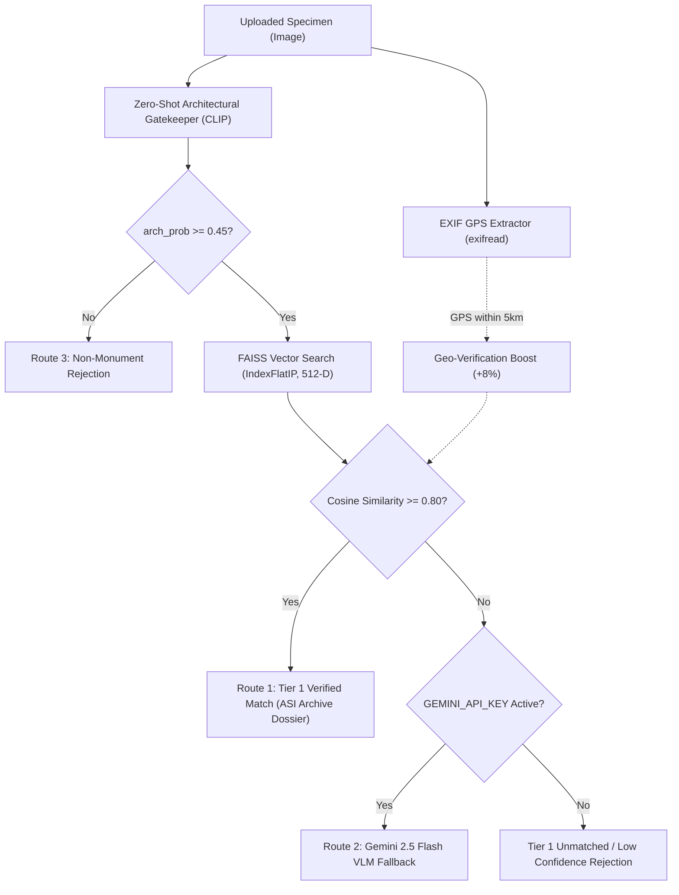

# Heritage & Monument Recognition System
### Two-Tier Hybrid Architecture: Local CLIP + FAISS Vector Engine & Gemini 2.5 Flash VLM Fallback

An AI and full-stack system designed to authenticate, identify, and catalog historical Indian monuments from uploaded photographs, field surveys, and camera captures.

---

## Architecture Overview



1. **Tier 1 (Local, Real-Time & Offline)**:
   - **Zero-Shot Gatekeeper**: Hugging Face `openai/clip-vit-base-patch32` compares image embeddings against precomputed positive heritage prompts vs negative non-architectural prompts using calibrated softmax scaling.
   - **Vector Database**: `faiss.IndexFlatIP(512)` containing 50 unit-normalized vectors (4 reference angles + 1 geometric centroid anchor per monument) providing exact cosine similarity matching in $< 5\text{ms}$.
   - **Geodetic Proximity**: Automatic Haversine GPS proximity validation against catalog coordinates.
2. **Tier 2 (Cloud VLM Deep Archaeological Fallback)**:
   - Multimodal `gemini-2.5-flash` with strict Pydantic JSON response schemas for unindexed monuments, extreme angles, or degraded lighting.
3. **The Curatorial Archive (Frontend)**:
   - Museum publication aesthetic with Alabaster paper (`#F7F5F0`), Ivory surface cards (`#FDFBF7`), Terracotta stamps (`#9E3B24`), interactive Leaflet cartography, and a live Pipeline Telemetry Inspector.

---

## Project Structure

```text
Heritage PJ/
├── backend/
│   ├── dataset/                        # Reference exterior images (40 verified photos)
│   │   ├── taj_mahal/
│   │   ├── qutub_minar/
│   │   ├── hawa_mahal/
│   │   ├── konark_sun_temple/
│   │   ├── gateway_of_india/
│   │   ├── charminar/
│   │   ├── hampi_stone_chariot/
│   │   ├── sanchi_stupa/
│   │   ├── victoria_memorial/
│   │   └── brihadeeswarar_temple/
│   ├── .env.example                    # Template for Google AI Studio API key
│   ├── requirements.txt                # Python dependencies
│   ├── monuments_metadata.json         # Structured metadata for 10 flagship monuments
│   ├── seed_dataset.py                 # Automated dataset scraper (Wikimedia API + DDGS)
│   ├── index_builder.py                # Extracts 512-D CLIP embeddings & builds FAISS index
│   ├── test_index.py                   # FAISS index self-retrieval verification suite
│   ├── main.py                         # Production FastAPI server & Two-Tier routing
│   ├── test_api.py                     # Integration test suite (TestClient 5/5 passed)
│   ├── monument_index.faiss            # Precomputed 50-vector FAISS index (100 KB)
│   └── monument_labels.json            # Ordered index-to-metadata mapping
├── frontend/
│   ├── src/
│   │   ├── components/
│   │   │   ├── Header.jsx              # Museum publication masthead
│   │   │   ├── CatalogDrawer.jsx       # 10-monument interactive reference catalog
│   │   │   ├── UploadSection.jsx       # Drag-and-drop & camera capture portal
│   │   │   ├── ProcessingOverlay.jsx   # Scanner reticle & vector progress overlay
│   │   │   ├── MonographResult.jsx     # Curatorial monograph split dossier
│   │   │   ├── MonumentMap.jsx         # Leaflet OpenStreetMap card with smooth flyTo
│   │   │   └── PipelineInspector.jsx   # Telemetry breakdown for demonstrations
│   │   ├── api.js                      # Backend API client
│   │   ├── App.jsx                     # Application coordinator
│   │   ├── index.css                   # Archival stamp and scanning styles
│   │   └── main.jsx
│   ├── package.json
│   ├── tailwind.config.js              # Curatorial archive theme tokens
│   └── vite.config.js
└── README.md
```

---

## Quickstart Guide

### 1. Prerequisites
- **Python**: Version 3.10 to 3.12 (Virtual environment configured in `.venv`)
- **Node.js**: Version 18+ (Node v20/v24 with `npm`)

---

### 2. Demo Credentials
The platform includes built-in curatorial authentication:
- **Email**: `curator@heritage.org`
- **Password**: `curator123`
- *(Alternatively, use the **"One-Click Curator Demo Login"** button on the sign-in screen or register a new personnel account via `/signup`)*

---

### 3. Running the FastAPI Backend

Open your first terminal in the project root:

```bash
# 1. Activate the Python virtual environment
# Windows PowerShell:
.venv\Scripts\Activate.ps1
# Or Command Prompt:
.venv\Scripts\activate.bat
# Linux/macOS:
source .venv/bin/activate

# 2. (Optional) Configure Gemini Tier 2 API Key
# Copy .env.example to backend/.env and supply your Google AI Studio key:
# GEMINI_API_KEY=your_actual_key_here
# Note: If omitted, the backend runs in 100% offline Tier 1 mode!

# 3. Start the FastAPI server
cd backend
python -m uvicorn main:app --reload --host 0.0.0.0 --port 8000
```

The backend will initialize the CLIP model, load the FAISS index, and serve the API on:
`http://localhost:8000` (Interactive Swagger docs: `http://localhost:8000/docs`)

---

### 3. Running the Vite React Frontend

Open a second terminal in the project root:

```bash
cd frontend

# Install dependencies (already prepared)
npm install

# Start the Vite development server
npm run dev
```

Open your browser and navigate to:
`http://localhost:5173`

---

## Testing & Verification Commands

All core modules include standalone verification suites:

```bash
# 1. Re-seed dataset images (Wikimedia Commons API with DDGS fallback):
python backend/seed_dataset.py

# 2. Re-build 50-vector FAISS index (CLIP ViT-B/32):
python backend/index_builder.py

# 3. Run FAISS self-retrieval perturbation test (Crop + Rotation):
python backend/test_index.py

# 4. Run full FastAPI backend integration tests (Health, Monuments, Taj Mahal, Charminar, Non-Monument Rejection):
python backend/test_api.py

# 5. Build production bundle for frontend:
cd frontend && npm run build
```

---

## API Endpoints Reference

| Method | Endpoint | Description |
| :--- | :--- | :--- |
| `GET` | `/api/health` | Returns live engine status, vector count, compute device, and Gemini status. |
| `GET` | `/api/monuments` | Returns the complete 10-monument catalog with historical metadata. |
| `POST` | `/api/verify-monument` | Upload an image file (`multipart/form-data`) to execute the two-tier verification pipeline. |
| `GET` | `/dataset/{monument}/{img}` | Static reference images served directly for UI previews and sample testing. |

---

## Curatorial UI Features

- **Double-Border Masthead**: Traditional archival publication header with live engine status.
- **Museum Archive Drawer**: Browse and inspect all 10 indexed monuments without uploading.
- **Deposit Drop Zone & Mobile Camera**: Drag-and-drop or use mobile device camera with `capture="environment"`.
- **Fast Evaluation Samples**: 1-click test buttons for Taj Mahal, Charminar, Hampi Chariot, Brihadeeswarar Temple, and Non-Monument rejection testing.
- **Interactive Monograph Dossier**: Inked archival stamps (`ASI-ARCH-TAJ-01`), architectural signatures, period analysis, and dynamic OpenStreetMap cartography.
- **Pipeline Inspector**: Full diagnostic telemetry showing EXIF GPS coordinates, Zero-Shot Gatekeeper score, and Top-3 FAISS nearest candidates.

