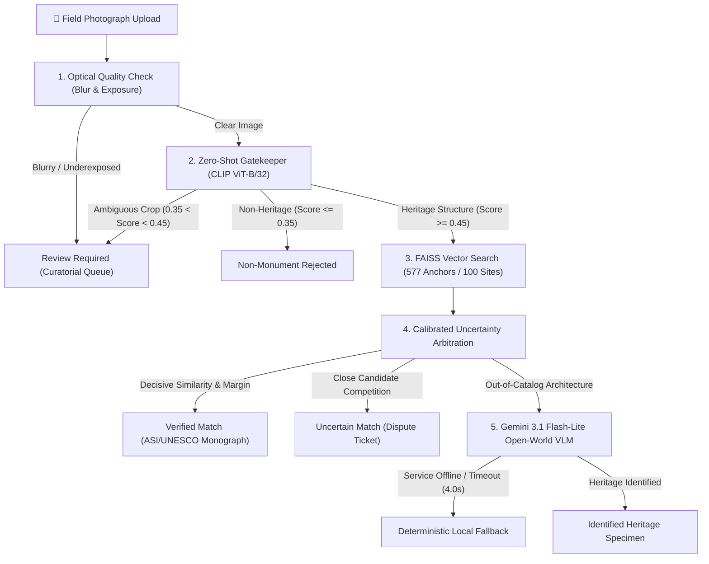

# 🏛️ Visual Heritage Recognition & Grounded Cultural Discovery Platform

> **AI-Powered Heritage Monument Identification, Architectural Explainability, and Statutory Grounded Historical Retrieval**  
> *Project No. 30 — Smart India Hackathon (SIH25052)*

<div align="center">

[](https://heritage-monuments.vercel.app)
[](https://backend-production-b023b.up.railway.app/api/health)
[](https://python.org)
[](https://react.dev)
[-EE4C2C?style=for-the-badge&logo=pytorch)](https://pytorch.org)
[](https://opensource.org/licenses/Apache-2.0)

</div>

---

## 🌟 Live Production Links

| Resource | URL | Status |
|---|---|---|
| **🎨 Interactive Web App** | [https://heritage-monuments.vercel.app](https://heritage-monuments.vercel.app) | `Online` (Global CDN) |
| **⚡ Backend API Gateway** | [https://backend-production-b023b.up.railway.app](https://backend-production-b023b.up.railway.app) | `Online` (Railway Cloud) |
| **📋 Interactive API Docs** | [https://backend-production-b023b.up.railway.app/docs](https://backend-production-b023b.up.railway.app/docs) | `Swagger UI` |
| **🩺 Health & Telemetry** | [https://backend-production-b023b.up.railway.app/api/health](https://backend-production-b023b.up.railway.app/api/health) | `JSON Telemetry` |

---

## 📸 Interface Preview

<div align="center">

### Desktop Experience
*Museum-grade curation dashboard with real-time vector attribution, geodetic verification, and architectural breakdown.*


<br/><br/>

### Mobile & Dossier Modal Experience
<table>
  <tr>
    <td align="center" width="50%">
      <b>Mobile Responsive Experience</b><br/>
      
    </td>
    <td align="center" width="50%">
      <b>Statutory Citations & Monograph Dossier</b><br/>
      
    </td>
  </tr>
</table>

</div>

---

## 📖 Overview

The **Visual Heritage Recognition Platform** is an institutional-grade cultural preservation and authentication system designed to identify and catalog monuments from user-submitted field photographs, archival scans, and mobile cameras.

Unlike generic image classifiers or hallucination-prone chatbots, this system is built with **strict zero-hallucination guarantees**:

1. **Grounded Statutory Citations**: Every date, dynasty, and architectural description is directly bound to official UNESCO World Heritage or Archaeological Survey of India (ASI) primary records.
2. **Explicit Uncertainty Arbitration**: Blurry photos, occluded viewpoints, or tight architectural details are quarantined into curatorial queues rather than forced into confident misidentifications.
3. **Calibrated Non-Monument Rejection**: Blatant non-heritage scenes (documents, everyday objects, pets) are rejected outright ($gatekeeper \le 0.35$), while ambiguous crops are preserved for expert review ($0.35 < gatekeeper < 0.45$).
4. **Deterministic Fallback Pipeline**: If Tier-2 cloud models encounter network timeouts or throttling, the system seamlessly transitions to local, verified metadata within 4.0 seconds.

---

## ⚙️ Recognition & Uncertainty Pipeline



### Calibrated Decision States

| Decision State | Trigger Condition | System Action | User Outcome |
|---|---|---|---|
| **`VERIFIED_MATCH`** | $top1 \ge 0.70$ and margin $\ge 0.08$ | Full monograph rendering | Instant identification with statutory citations and interactive map. |
| **`UNCERTAIN_MATCH`** | $top1 \ge 0.70$ and margin $< 0.08$ | Candidate competition arbitration | Displays top competing monuments for user confirmation. |
| **`REVIEW_REQUIRED`** | Low quality, ambiguous gatekeeper, or EXIF conflict | Queued into curatorial log | Explains exact reason (e.g. `GATEKEEPER_AMBIGUOUS`, `BLUR_DETECTED`). |
| **`NON_MONUMENT_REJECTED`** | $top1 < 0.70$ and $gatekeeper \le 0.35$ | Clean rejection | Informs user that the image contains no recognizable monument. |
| **`UNKNOWN_HERITAGE_SPECIMEN`** | $gatekeeper \ge 0.45$ but $top1 < 0.70$ | Invokes Tier-2 VLM | Open-world architectural analysis via Gemini 3.1 Flash-Lite. |

---

## 📂 Project Directory Structure

```text
Heritage-Recognisation-System/
├── backend/                        # FastAPI Backend & Inference Engine
│   ├── main.py                     # API router, CORS & endpoint declarations
│   ├── calibration.py              # Calibrated uncertainty & gatekeeper logic
│   ├── uncertainty.py              # 5-state decision policy & arbitration
│   ├── knowledge_engine.py         # 100-monument grounded ASI/UNESCO database
│   ├── gemini_client.py            # Tier-2 VLM with non-blocking timeouts
│   ├── rate_limiter.py             # Sliding-window IP rate limiter
│   ├── test_*.py                   # Backend automated test suites
│   └── monuments_metadata.json     # Curated monument monographs & geocoordinates
├── frontend/                       # React 18 + Vite Web Application
│   ├── src/
│   │   ├── components/             # Atrium UI, Dossier, Timeline, Scanner
│   │   ├── services/api.js         # Backend API client
│   │   └── index.css               # Tailwind CSS theme & typography
│   ├── package.json                # Frontend dependencies
│   └── vite.config.js              # Vite build configuration
├── docs/                           # Architecture & Engineering Documentation
│   ├── assets/                     # Visual assets & UI screenshots
│   ├── reports/                    # 22 Historical Phase Audits & Benchmarks
│   └── README.md                   # Complete Documentation Index
├── requirements.txt                # Python backend dependencies
├── Dockerfile                      # Container build definition for Railway
└── README.md                       # Project Landing Page
```

---

## 🚀 Quickstart Guide (Running Locally)

### 1. Prerequisites
- **Python**: Version 3.10 – 3.12 installed.
- **Node.js**: Version 18+ and `npm` installed.
- **Git**

### 2. Backend Setup
```bash
# 1. Clone repository
git clone https://github.com/humaidmalik63-png/Heritage-Recognisation-System.git
cd Heritage-Recognisation-System

# 2. Create and activate virtual environment
python -m venv .venv
.\.venv\Scripts\Activate.ps1       # On Windows PowerShell
# source .venv/bin/activate        # On Linux / macOS

# 3. Install dependencies
pip install -r requirements.txt

# 4. Start the backend server
uvicorn backend.main:app --host 127.0.0.1 --port 8000 --reload
```
*API will be available at `http://127.0.0.1:8000` (Swagger docs at `http://127.0.0.1:8000/docs`).*

### 3. Frontend Setup
```bash
# 1. Navigate to frontend directory
cd frontend

# 2. Install dependencies
npm install

# 3. Start development server
npm run dev
```
*Open your browser at `http://localhost:5173`.*

---

## 🧪 Comprehensive Verification Suite

The repository includes automated test suites covering uncertainty boundaries, security hardening, fallback timeouts, concurrency bounds, and UI rendering:

```bash
# 1. Uncertainty Boundary & Invariant Audit (18/18 Tests)
python backend/test_uncertainty_boundaries.py

# 2. Grounded Knowledge Engine & Anti-Hallucination 404s (10/10 Tests)
python backend/test_knowledge_engine.py

# 3. Security Hardening, Rate Limiting & Auth (17/17 Tests)
python test_phase_11_security.py

# 4. Fallback Timeouts & Non-Blocking Deadlines (5/5 Tests)
python test_phase_13_4b_audit.py

# 5. Concurrency & Atomic Admission Control (4/4 Tests)
python test_phase_13_4c_concurrency_lifecycle.py

# 6. Three-Way Paired Benchmark Evaluation (136 Specimens)
python backend/run_paired_evaluation.py

# 7. Frontend React Hook Lifecycle Stability (14 Scenarios)
node frontend/verify_hook_stability.cjs

# 8. Frontend Monograph Render Verification (7 States)
node frontend/test_monograph_states.cjs

# 9. Production Frontend Build Check
npm --prefix frontend run build
```

---

## 📚 Historical Engineering & Phase Reports

All 22 historical audit reports, benchmark evaluations, memory optimization studies, and deployment gates are preserved in **[`docs/reports/`](docs/reports/)**.

See the **[Complete Documentation Index](docs/README.md)** for detailed phase-by-phase records:
- **Phase 14**: Calibrated Uncertainty & Paired Benchmark Evaluation
- **Phase 13**: Security Hardening, Rate Limiting & Concurrency Lifecycle
- **Phase 10**: Atrium Museum UI/UX & Mobile Viewport Adaptation
- **Foundational**: PyTorch CPU Optimization, Vector Benchmarking, and Cloud Hosting Audits

---

## 📄 License & Statutory Attribution

- **Source Code**: Released under the [Apache 2.0 License](LICENSE).
- **Heritage Data & Imagery**: Curated from public-domain and statutory inventories maintained by the **Archaeological Survey of India (ASI)**, the **Ministry of Culture, Government of India**, and the **UNESCO World Heritage Centre**.
