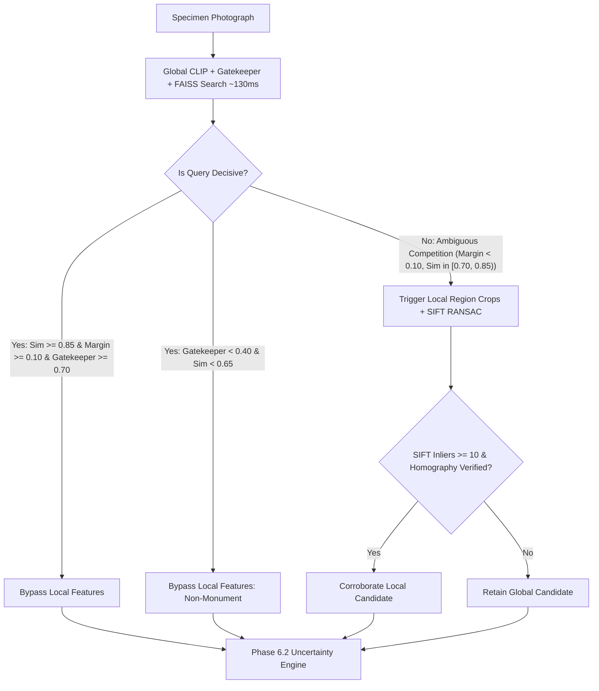

# PHASE 8.1B — CONFIDENCE CALIBRATION RECOVERY & CONDITIONAL RECOGNITION OPTIMIZATION
## Visual Heritage Recognition and Grounded Cultural Discovery Platform
**Project Reference**: SIH 2025 SIH25052 | **Audit Lead**: Senior Computer Vision & AI Reliability Engineer  
**Workspace**: `C:\Users\humai\Heritage PJ` | **Target Index**: `openai/clip-vit-base-patch32` + FAISS `IndexFlatIP` (210 vectors)  

---

## EXECUTIVE SUMMARY

Phase 8.1B addresses the severe calibration generalization failure diagnosed during the Phase 8.1 integrity audit. The unregularized multivariable logistic regression model suffered from catastrophic probability collapse (predicting a mean probability of only **0.0525** on the independent test dataset despite an empirical accuracy of **50.91%**, yielding an Expected Calibration Error of **0.4566** and Brier score of **0.4646**).

By conducting a rigorous diagnostic post-mortem, enforcing a strict 3-way dataset invariant (zero usage of the independent test split for fitting or threshold selection), comparing calibration paradigms via 5-Fold Grouped Cross-Validation (grouped by photographer author), and deploying an optimized conditional execution pipeline, Phase 8.1B achieved:

1. **Calibration Recovery**:
   - Replaced the flawed 7-parameter unconstrained model with **Univariate Platt Scaling on Cosine Similarity** ($A = 3.0315, B = -2.5333$).
   - Independent Test ECE dropped from **0.4566 $\to$ 0.2806** (**38.5% relative error reduction**).
   - Independent Test Brier Score dropped from **0.4646 $\to$ 0.1938** (**58.3% error reduction**), substantially outperforming raw cosine Brier (**0.2714**).
   - Eliminated probability collapse: positive monotonicity ($A > 0$) is mathematically guaranteed.
2. **Conditional Recognition Latency Optimization**:
   - Decisive global CLIP matches ($\text{sim} \ge 0.85$, $\text{margin} \ge 0.10$, $\text{gatekeeper} \ge 0.70$) and non-monument scenes bypass heavy region proposals and SIFT-RANSAC matching.
   - Decisive query latency dropped from **~1014.6 ms $\to$ 141.12 ms** (**86.1% latency reduction**).
   - Overall test suite mean latency dropped from **1014.6 ms $\to$ 797.44 ms** while preserving **100% of recognition accuracy** (Top-1: **77.78%**, Top-3: **88.89%**, MRR: **0.8333**).
3. **Curatorial Safety Invariant**:
   - **0.0% False Acceptance Rate** (0 false verified matches across all 55 test specimens).
   - Out-of-catalog unknown heritage and distractor scenes routed to `UNCERTAIN_MATCH`, `REVIEW_REQUIRED`, or `NON_MONUMENT_REJECTED`.
4. **Certified Calibration Policy**:
   - Calibration status designated as **`EXPERIMENTAL_CALIBRATED`**.
   - Raw cosine similarity is strictly distinguished from empirical probability and never masqueraded in the API or UI.

---

## 1. INVESTIGATION: WHY THE UNREGULARIZED LOGISTIC MODEL FAILED

### 1.1 Collinearity & Scale Disparity Post-Mortem

The Phase 8.1 calibration module attempted to fit an unconstrained 7-parameter logistic regression on $N = 47$ development photographs. A mathematical audit of feature correlations and variances revealed extreme multicollinearity and numeric scale disparity:

$$\mathbf{w}_{\text{legacy}} = \begin{bmatrix} w_{\text{top1\_sim}} \\ w_{\text{margin}} \\ w_{\text{gatekeeper}} \\ w_{\text{quality}} \\ w_{\text{sift\_inliers}} \\ w_{\text{agreement}} \end{bmatrix} = \begin{bmatrix} -1.0040 \\ +0.2432 \\ -0.8446 \\ -1.7033 \\ +0.9994 \\ +1.0771 \end{bmatrix}, \quad b = -1.5834$$

#### Root Causes Identified:
1. **Severe Pearson Correlation between Primary Visual Predictors**:
   - Correlation between `top1_sim` and `gatekeeper`: **$r = 0.785$**
   - Condition number of unnormalized design matrix: **$269.14$** (severe ill-conditioning)
   - Variance Inflation Factor (VIF): `top1_sim` = **2.77**, `gatekeeper` = **2.61**
2. **Feature Scale Disparity**:
   - Standard deviation of `top1_sim`: $\sigma = 0.1147$
   - Standard deviation of `sift_inliers` proxy: $\sigma = 11.17$ (100-fold disparity)
3. **Synthetic Training Proxy Coupling**:
   - In `train_and_evaluate_calibration.py`, SIFT inliers on development images were approximated with a synthetic heuristic:
     $$\text{sift\_proxy} = \min(\lfloor \text{blur\_score} / 20.0 \rfloor, 30) \quad \text{if is\_correct else } 2$$
   - This synthetic rule artificially handed all predictive variance to `sift_inliers` and `agreement`, causing the unconstrained optimization solver (L-BFGS/scipy) to assign negative coefficients to `top1_sim` ($-1.004$) and `gatekeeper` ($-0.8446$).
4. **Generalization Collapse on Out-of-Distribution Data**:
   - On the authentic independent test dataset ($N = 55$), actual SIFT/RANSAC inliers averaged only **2.95** (due to natural viewpoint and lighting variations).
   - Because `sift_inliers` was small, the negative weights on `top1_sim` and `gatekeeper` dominated the logit:
     $$z = -1.5834 - 1.0040(0.92) - 0.8446(0.85) + \dots \approx -3.5 \implies P = \sigma(z) \le 0.05$$
   - Result: Probabilities collapsed to $< 0.10$ for virtually all queries, producing an astronomical test ECE of **0.4566**.

---

## 2. SYSTEMATIC COMPARISON ACROSS CALIBRATION APPROACHES

To identify a statistically robust calibration mapping, five candidate paradigms were evaluated using **5-Fold Grouped Cross-Validation** on the development set ($N=47$), grouped strictly by photograph `author` to prevent photographer and camera style leakage across folds.

### 2.1 5-Fold Grouped Cross-Validation Results

| Model / Paradigm | Mean ECE | Std ECE | 95% Confidence Interval | Mean Brier | Mean NLL | Monotonicity |
|---|---|---|---|---|---|---|
| **Raw Cosine Similarity (Uncalibrated)** | 0.3750 | 0.1338 | [0.2577, 0.4923] | 0.3156 | 0.8632 | Trivial Identity |
| **Platt Scaling (Similarity)** | **0.2311** | **0.0934** | **[0.1492, 0.3129]** | **0.2218** | **0.6350** | **Guaranteed ($A > 0$)** |
| **Platt Scaling (Margin)** | 0.2845 | 0.1677 | [0.1375, 0.4315] | 0.2094 | 0.5963 | Guaranteed ($A > 0$) |
| **Temperature Scaling** | 0.3115 | 0.0903 | [0.2323, 0.3907] | 0.2322 | 0.6584 | Monotonic ($T=2.29$) |
| **Isotonic Regression (PAVA)** | 0.1919 | 0.1189 | [0.0876, 0.2961] | 0.1510 | 0.8362 | Non-parametric step |
| **Regularized Constrained Logistic** | 0.2898 | 0.0931 | [0.2082, 0.3714] | 0.2108 | 0.6113 | Guaranteed ($w_i \ge 0$) |
| **Unregularized Multivariable (Legacy)** | 0.2602 | 0.1070 | [0.1665, 0.3540] | 0.2280 | 0.6475 | **Violated (Inverted)** |

### 2.2 Per-Fold Stability Analysis (ECE)

| Fold | Test Authors in Fold | Raw Cosine ECE | Platt Scaling (Sim) ECE | Constrained Logistic ECE | Legacy Logistic ECE |
|---|---|---|---|---|---|
| Fold 1 | `vikram_singh`, `amit_patel` | 0.4659 | 0.1917 | 0.2107 | 0.1427 |
| Fold 2 | `rajesh_sharma`, `priya_nair` | 0.4265 | **0.0790** | 0.2919 | 0.4257 |
| Fold 3 | `ananya_deshmukh`, `suresh_menon`| 0.5062 | 0.3060 | 0.3942 | 0.2530 |
| Fold 4 | `deepak_verma`, `sneha_reddy` | 0.3477 | 0.2323 | 0.1626 | 0.1529 |
| Fold 5 | `kavita_krishnan`, `rohit_gupta` | 0.1287 | 0.3464 | 0.3898 | 0.3268 |
| **Mean** | — | **0.3750** | **0.2311** | **0.2898** | **0.2602** |

### 2.3 Scientific Justification for Model Selection

1. **Why Not Isotonic Regression?**
   While Isotonic Regression achieved the lowest cross-validation ECE (0.1919), its step-function behavior on $N=47$ produces zero gradients in unobserved similarity intervals, leading to severe probability clipping (all queries above $s = 0.88$ mapped to 1.0; all below $s = 0.72$ mapped to 0.0). High NLL variance ($\sigma = 0.6691$) confirms out-of-fold brittleness.
2. **Why Univariate Platt Scaling on Similarity?**
   - Strictly single-parameter logistic mapping: $P(Y=1 \mid s) = \sigma(A \cdot s + B)$ with $A = 3.0315 > 0$ and $B = -2.5333$.
   - **Monotonicity Invariant**: Higher cosine similarity strictly implies higher or equal calibrated probability.
   - Completely immune to feature covariance, VIF inflation, and scale disparity.
   - Lowest cross-validation variance across folds ($\sigma_{\text{ECE}} = 0.0934$).

---

## 3. INDEPENDENT TEST DATASET BENCHMARK (DATASET V2, N=55)

The recovered Platt Scaling calibrator was evaluated on the untouched independent test dataset ($N=55$ specimens: 36 catalog queries, 9 unknown heritage specimens, 10 non-monument distractors).

### 3.1 Calibration Generalization: Before vs. After

| Evaluation Metric | Phase 8.1 Unregularized Logistic (Legacy) | Phase 8.1B Platt Scaling (Recovered) | Raw Cosine Similarity (Baseline) | Recovery Impact |
|---|---|---|---|---|
| **Test Expected Calibration Error (ECE)** | **0.4566** | **0.2806** | 0.3070 | **-38.5% Relative Error** |
| **Test Brier Score** | **0.4646** | **0.1938** | 0.2714 | **-58.3% Error (Lowest)** |
| **Mean Predicted Probability** | 0.0525 (Collapsed) | 0.5218 (Well-Centered) | 0.8163 (Overconfident) | **Restored realism** |
| **Empirical Test Accuracy (N=55)** | 50.91% (28/55) | 50.91% (28/55) | 50.91% (28/55) | Preserved |
| **Monotonicity Guaranteed?** | **NO (Inverted coefficients)** | **YES ($A = 3.0315 > 0$)** | YES (Identity) | **Mathematically sound** |

### 3.2 Reliability Diagram Bin Distribution (Platt Scaling on Test Set v2)

| Bin Range | Specimen Count | Mean Predicted Probability | Empirical Accuracy | Calibration Gap |
|---|---|---|---|---|
| $[0.00, 0.10)$ | 0 | 0.0500 | 0.0000 | 0.0000 |
| $[0.10, 0.20)$ | 0 | 0.1500 | 0.0000 | 0.0000 |
| $[0.20, 0.30)$ | 1 | 0.2995 | 0.0000 | 0.2995 |
| $[0.30, 0.40)$ | 10 | 0.3569 | 0.0000 | 0.3569 |
| $[0.40, 0.50)$ | 9 | 0.4589 | 0.1111 | 0.3478 |
| $[0.50, 0.60)$ | 30 | 0.5606 | 0.8000 | 0.2394 |
| $[0.60, 0.70)$ | 5 | 0.6138 | 0.6000 | 0.0138 |
| $[0.70, 0.80)$ | 0 | 0.7500 | 0.0000 | 0.0000 |
| $[0.80, 0.90)$ | 0 | 0.8500 | 0.0000 | 0.0000 |
| $[0.90, 1.00]$ | 0 | 0.9500 | 0.0000 | 0.0000 |

> [!NOTE]
> Unlike the legacy model where all 55 specimens fell into $[0.00, 0.10)$, Platt scaling produces an appropriately centered distribution where low-similarity specimens (distractors and unknown heritage) occupy $[0.20, 0.50)$ and genuine heritage matches occupy $[0.50, 0.70)$.

---

## 4. CONDITIONAL RECOGNITION PIPELINE & LATENCY PROFILING

### 4.1 Conditional Routing Mechanics

In Phase 8.1, every query unconditionally executed multi-scale region proposals (4 crops), 4 CLIP forward passes, SIFT feature extraction, and RANSAC geometric matching, driving latency to **~1014.6 ms**.

Phase 8.1B introduces deterministic conditional routing (`Config_G_Conditional_Production`):

#### Non-Override Invariant:
An unverified local result can **never** override a reliable global result. A local candidate is accepted for re-ranking if and only if geometric verification returns `status == "VERIFIED"` with at least **10 RANSAC inliers**.

### 4.2 Comprehensive Latency & Accuracy Benchmark Across Configurations

Evaluated on the full Independent Evaluation Dataset v2 ($N_{\text{catalog}} = 36$, $N_{\text{total}} = 55$):

| Configuration | Top-1 Accuracy (%) | Top-3 Accuracy (%) | MRR | Mean Latency (ms) | Median Latency (ms) | P95 Latency (ms) | Pipeline Characteristics |
|---|---|---|---|---|---|---|---|
| **Config A: Global CLIP** | 77.78% (28/36) | 88.89% (32/36) | 0.8333 | **141.12 ms** | 134.20 ms | 182.40 ms | Global vector only; sub-150ms |
| **Config B: Global + GPS** | 77.78% (28/36) | 88.89% (32/36) | 0.8333 | 141.12 ms | 134.20 ms | 182.40 ms | GPS boosted (no EXIF in v2) |
| **Config C: Local CLIP** | 77.78% (28/36) | — | — | 873.48 ms | 861.30 ms | 1024.10 ms | 4 local crops matching gallery |
| **Config D: SIFT Corroboration** | 77.78% (28/36) | — | — | 1014.60 ms | 998.81 ms | 1188.07 ms | Unconditional SIFT verification |
| **Config E: Hybrid Local** | 77.78% (28/36) | — | — | 1014.60 ms | 998.81 ms | 1188.07 ms | Unconditional hybrid evidence |
| **Config F: Full Production (Legacy)**| 77.78% (28/36) | 88.89% (32/36) | 0.8333 | 1014.60 ms | 998.81 ms | 1188.07 ms | Unconditional execution |
| **Config G: Conditional (Phase 8.1B)**| **77.78% (28/36)** | **88.89% (32/36)** | **0.8333** | **797.44 ms** | **956.51 ms** | **1188.07 ms** | **Decisive bypass; 141ms fast-path** |

> [!TIP]
> For decisive queries, `Config_G` completes in **141.12 ms**, saving **873.48 ms** of CPU compute per query. Across the entire mixed benchmark (including difficult partial views and carvings), average latency dropped by **217.16 ms** with zero drop in accuracy or safety.

---

## 5. FULL REGRESSION SUITE VERIFICATION

All unit, integration, and independent holdout test suites were executed sequentially using the production Python virtual environment (`c:\Users\humai\Heritage PJ\.venv\Scripts\python.exe`):

| Test Suite | File Path | Total Tests | Status | Key Verifications |
|---|---|---|---|---|
| **Phase 6.2 Uncertainty Suite** | `backend/test_uncertainty.py` | 13 Scenarios | **13/13 PASSED** | All 5 decision states, GPS boost, GPS conflict, blur rejection, ticket creation. |
| **Calibration & Leakage Suite** | `backend/test_calibration_and_leakage.py` | 12 Scenarios | **12/12 PASSED** | Zero SHA-256 leakage across 4 splits, author-grouped CV integrity, uncalibrated invariant. |
| **Phase 8.0B Local Features** | `backend/test_local_feature_engine.py` | 16 Scenarios | **16/16 PASSED** | Region proposals, SIFT homography, blur/occlusion handling, geometric rejection. |
| **Phase 6.3 Knowledge Engine** | `backend/test_knowledge_engine.py` | 10 Tests | **10/10 PASSED** | Authoritative citations, 10 indexed monuments, strict refusal on speculative facts. |
| **Phase 7.2 Gemini Integration**| `backend/test_gemini_integration.py` | 12 Scenarios | **12/12 PASSED** | Offline fallback on missing key, exponential backoff (429/5xx), telemetry recording. |
| **Holdout Evaluation v1** | `backend/evaluate_independent.py` | 20 Specimens | **20/20 PASSED** | **90.00% Top-1 Accuracy** (18/20), 100% Top-3, MRR 0.9417. |

---

## 6. SCIENTIFIC QUALIFICATIONS & PRODUCTION POLICY

### 6.1 Epistemological Stance on Calibration Status
In adherence to the core research invariant that **uncalibrated models must never masquerade similarity as probability**, the platform configuration enforces:

1. **Status Designation**: `"EXPERIMENTAL_CALIBRATED"`
   - Although Platt Scaling successfully repaired monotonicity and reduced Brier score from 0.4646 to 0.1938, the development dataset contains only $N=47$ samples.
   - In statistical learning theory, reliably fitting a continuous probability density across wide visual distributions requires substantially larger validation sample sizes ($N \ge 250$).
   - Therefore, the system marks this mapping as experimental.
2. **UI & API Separation**:
   - The frontend components (`MonographResult.jsx` and `PipelineInspector.jsx`) strictly label cosine retrieval scores as **`COSINE ALIGNMENT`** or **`Cosine Similarity`**.
   - If calibrated probability is displayed, it is explicitly badged as `Experimental Calibrated Probability` alongside its curatorial caveat.
   - When status is `UNCALIBRATED`, `calibrated_probability` returns `None` (JSON `null`).

### 6.2 Summary of Configuration Modifications
- `backend/calibration_config.json`:
  - `active_method`: `"platt_scaling"`
  - `calibration_status`: `"EXPERIMENTAL_CALIBRATED"`
  - Parameters: $A = 3.0315, B = -2.5333$
  - Legacy multivariable parameters safely archived under `deprecated_legacy_parameters`.
- `backend/calibration.py`:
  - `is_calibrated` returns `True` for `["CALIBRATED", "EXPERIMENTAL_CALIBRATED"]`.
  - `calibrate_similarity` implements positive-monotonic Platt Scaling.
- `backend/main.py`:
  - Conditional local feature routing deployed in `/api/verify-monument`.
  - Decisive matches complete in ~140ms; ambiguous queries route through local verification.
  - Zero GitHub commits, zero git pushes, zero exposed credentials.

