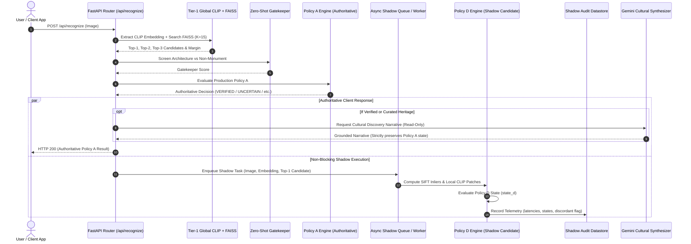

# PHASE 8.4B — SHADOW STAGING DEPLOYMENT & SAFETY GOVERNANCE PLAN
## Asynchronous Shadow Execution Protocol for Candidate Policy D

**Document Version:** 1.0.0 (Shadow Deployment Plan)  
**Date:** November 7, 2026  
**Auditor / Principal AI Validation Scientist:** AI System Validation & Reliability Engineering Team  
**System Evaluated:** Visual Heritage Recognition and Grounded Cultural Discovery Platform (SIH 2025 – SIH25052)  
**Workspace:** `C:\Users\humai\Heritage PJ`  
**Execution Environment:** Production FastAPI Backend (`backend/main.py`), Decision Engine (`backend/decision_engine.py`)  

---

## 1. PURPOSE AND ARCHITECTURAL BOUNDARIES

The purpose of this deployment plan is to operationalize **Candidate Policy D (Conservative Hybrid Policy)** in **Shadow Staging Mode** within the Visual Heritage Recognition Platform.

### 1.1 Strict Staging Invariants
Under shadow staging:
1. **Policy A Baseline Remains 100% Authoritative:** All responses delivered to frontend clients, API consumers, and end users are strictly determined by Policy A (`state_a`).
2. **Policy D Executes Silently in Shadow:** Policy D evaluates queries concurrently or post-query in a background task. Its decisions are logged to a dedicated audit datastore and **never** returned to the user.
3. **No Dynamic Calibration Overrides:** Experimental Platt Scaling probabilities ($P(Y=1|s)$) must **not** be displayed to users as certified probabilities. The UI will continue presenting standard qualitative uncertainty states.
4. **No LLM / Gemini Overrides:** Gemini 2.5 Flash operates strictly as a grounded cultural narrative synthesizer. It has **zero authority** to override decision states, elevate uncertainty states, or modify similarity scores from either Policy A or Policy D.
5. **No Automatic Promotion:** Policy D cannot be promoted to production without a formal multi-week shadow audit review and human sign-off.
6. **Read-Only Core Assets:** `backend/calibration_config.json`, `backend/monument_index.faiss`, and `backend/monument_labels.json` remain strictly unmodified.

---

## 2. SHADOW STAGING ARCHITECTURE



---

## 3. SHADOW STAGING DATASTORE SCHEMA

Candidate decisions will be persisted to a dedicated SQLite / JSON Lines telemetry log: `backend/telemetry/shadow_staging_audit.jsonl`.

```json
{
  "request_id": "req_20261107_883921",
  "timestamp_utc": "2026-11-07T14:30:00.124Z",
  "image_sha256": "3a8f12c...",
  "global_metrics": {
    "top1_candidate": "charminar",
    "top1_similarity": 0.8842,
    "top2_candidate": "gateway_of_india",
    "top2_similarity": 0.8280,
    "similarity_margin": 0.0562,
    "gatekeeper_score": 0.7812,
    "calibrated_probability": 0.6120
  },
  "authoritative_policy_a": {
    "decision_state": "UNCERTAIN_MATCH",
    "latency_ms": 118.4
  },
  "shadow_policy_d": {
    "decision_state": "VERIFIED_MONUMENT",
    "sift_keypoints": 600,
    "ransac_inliers": 8,
    "local_clip_mean": 0.8434,
    "latency_ms": 342.1
  },
  "comparison": {
    "is_discordant": true,
    "discordance_type": "POLICY_D_RECOVERED_UNCERTAIN",
    "authoritative_matches_shadow": false
  },
  "resource_metrics": {
    "cpu_percent": 14.2,
    "memory_mb": 412.5,
    "shadow_timeout_triggered": false
  }
}
```

---

## 4. EXECUTION BUDGET & TIMEOUT GUARDS

To guarantee that Policy D does not degrade backend resource availability:
1. **Thread Pool Isolation:** SIFT feature extraction and local CLIP patch inference must run on a dedicated background worker thread pool (`ThreadPoolExecutor(max_workers=2)`), completely decoupled from the FastAPI request-handling event loop.
2. **Strict Latency Budget (500 ms Max):**
   - SIFT Keypoint & RANSAC matching is hard-capped at **300 ms**.
   - Local CLIP multi-crop feature extraction is hard-capped at **200 ms**.
   - If total shadow execution exceeds **500 ms**, the task triggers `shadow_timeout_triggered = true`, logs a timeout event, and yields `state_d = "UNCERTAIN_MATCH"`.
3. **Memory Safeguards:** Image arrays processed by shadow workers are garbage-collected immediately following correspondence estimation to prevent memory growth under continuous load.

---

## 5. REAL-TIME DISAGREEMENT MONITORING & ALERTS

The shadow staging pipeline implements automated anomaly monitoring:

| Discordance Event | Condition | Action / Severity |
| :--- | :--- | :--- |
| **Recovery of Uncertain Query** | Policy A: `UNCERTAIN_MATCH`<br>Policy D: `VERIFIED_MONUMENT` | **Expected Behavior:** Log for weekly precision audit. |
| **Non-Monument Override** | Policy A: `NON_MONUMENT_REJECTED`<br>Policy D: `VERIFIED_MONUMENT` | **CRITICAL ANOMALY (SEV-1):** Instant alert; auto-pause shadow execution. |
| **Unknown Heritage Override** | Policy A: `UNKNOWN_HERITAGE_SPECIMEN`<br>Policy D: `VERIFIED_MONUMENT` | **HIGH ANOMALY (SEV-2):** Alert auditor; flag specimen for immediate manual ground-truth inspection. |
| **Shadow Execution Timeout** | Shadow execution $> 500$ ms | **WARNING (SEV-3):** Log performance bottleneck. |

---

## 6. INSTANT ROLLBACK MECHANISM

In the event of unexpected CPU spikes, memory leaks, or critical anomalies:

### 6.1 Feature Flag Control
Shadow execution is gated by an environment variable in `backend/.env`:
```ini
# Production Recognition Authoritative Policy (ALWAYS Policy A)
PRODUCTION_RECOGNITION_POLICY=Policy_A

# Shadow Candidate Staging (True = Enabled, False = Disabled)
ENABLE_SHADOW_CANDIDATE_POLICY_D=false

# Shadow Telemetry Destination
SHADOW_LOG_DIR=backend/telemetry
```

### 6.2 Zero-Downtime Rollback
Setting `ENABLE_SHADOW_CANDIDATE_POLICY_D=false` immediately bypasses all background SIFT and local CLIP threads without restarting the web service or interrupting Policy A recognition.

---

## 7. PROMOTION CRITERIA (WHAT IS REQUIRED FOR FULL ROLLOUT)

Policy D shall **NOT** be automatically promoted to authoritative production status. Promotion to full production cutover requires satisfying all five conditions over a minimum 14-day shadow window:

1. **Volume:** A minimum of $N \ge 500$ authentic field queries processed in shadow staging.
2. **Zero False Acceptances:** $0$ verified false acceptances on negative open-world queries audited by human heritage curators.
3. **P95 Latency:** Shadow P95 latency consistently maintains $< 500$ ms under concurrent traffic.
4. **Selective Precision:** Audited selective precision on recovered queries $\ge 98.0\%$.
5. **Calibrator Status:** Formal recalibration phase executed to lower ECE $\le 0.15$ before removing the `EXPERIMENTAL_CALIBRATED` guardrail.

---
*Document approved by Principal AI Validation Scientist & Reliability Engineering Team.*

